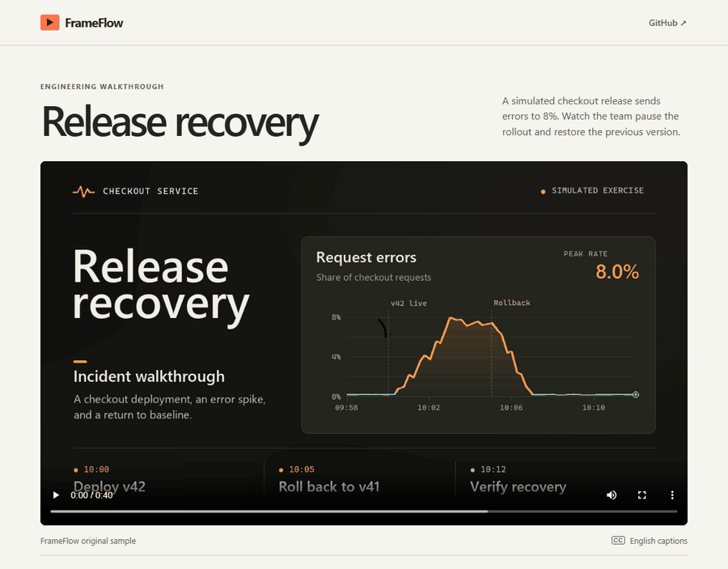

# FrameFlow

FrameFlow is a video platform in development. Its local Next.js player features a 52-second excerpt from **Caminandes: Llamigos**, a colorful animated comedy set in Patagonia. A llama and a penguin’s squabble over berries turns into a runaway mine-cart ride.



Blender Foundation released the film in 2016, directed by Pablo Vazquez, with music by Torin Borrowdale and sound design by Sander Houtman. FrameFlow uses 0:49.875–1:41.792 of the film, re-encoded at 720p with brief audio fades at the cut points. The poster and player preview use frames from the same excerpt. [Original film](https://www.youtube.com/watch?v=SkVqJ1SGeL0) · [Blender’s source MP4](https://video.blender.org/download/web-videos/23f3ef79-15dc-44c5-aa45-cf92e78a4509-1080.mp4) · [Creative Commons Attribution 3.0 license](https://creativecommons.org/licenses/by/3.0/)

## Run the player locally

Use Node.js 24 and pnpm 11.25.0. Run these commands from the repository root.

```sh
pnpm install --frozen-lockfile
pnpm dev
```

Open [localhost:3000](http://localhost:3000) or the address printed by Next.js. The video and poster are included in the repository. Playback works locally without an account or cloud services.

If pnpm is missing, install it with `npm install --global pnpm@11.25.0`. On Windows, `npm.cmd` and `pnpm.cmd` also work in PowerShell.

Run `pnpm typecheck` and `pnpm build` to check the project. Use `pnpm start` to serve the production build. GitHub Actions runs the checks for pull requests and changes to `main`.

## Planned features

### Upload, processing, and playback

- Users will upload large video files directly from their browsers to Amazon S3.
- Amazon SQS will queue processing jobs. Distributed workers will pick up each job and use FFmpeg to transcode the video into multiple resolutions in the background.
- Viewers will stream the processed videos through Amazon CloudFront.

### Understanding and searching videos

- FrameFlow will transcribe spoken audio and generate a summary for each video.
- Viewers will be able to search by meaning. FrameFlow will match a query against embeddings of timestamped transcript segments stored in PostgreSQL with pgvector.
- Fine-tuned machine learning models will classify videos by their content.
